# Keel

**A markdown life organizer for Windows.** Daily logs, tasks, meeting notes, reminders, hours worked
and loose notes, all kept as plain `.md` files in one folder you own (the **Hold**). Keel adds the
views on top: today's agenda, a weekly timesheet, client status reports, sticky-note Flags, and a
quick-capture box you can open from anywhere in Windows.

There's no account, no server and no sync service. Open the same files in VS Code, Obsidian or Notepad
whenever you like; Keel picks up the changes.

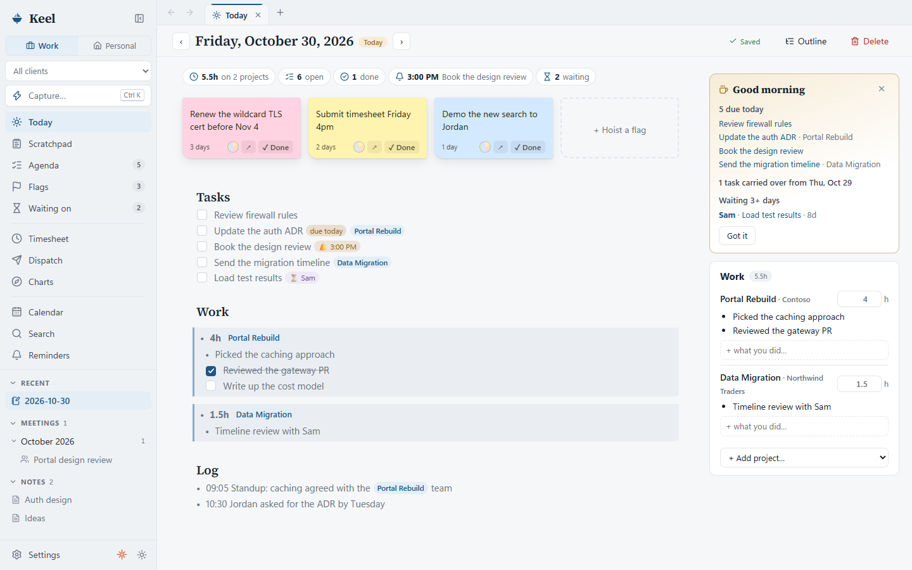

## Highlights

- **A log for every day.** Tasks, the work you did per project, and a running log. Unfinished tasks
  roll over to the next day on their own.
- **Plain text you can type fast.** `- [ ] Update the ADR @due(2026-11-03) @portal-rebuild` is a task with a
  due date, filed under a project. Tokens show as chips while you're not editing the line.
- **Hours without the busywork.** One line per project per day (`- 4h @portal-rebuild`) with what you
  did underneath. The Timesheet turns that into a week grid you can copy into your time system.
- **Client status reports.** Dispatch builds a weekly update from your logs, meetings and tasks.
- **Quick capture.** Ctrl+Alt+K anywhere in Windows: log hours, add a task, set a reminder, hoist a flag.
- **Work and personal modes.** A separate personal space with its own logs, plus shopping lists and recipes.
- **Light and dark themes**, tabs, a command list (Ctrl+Shift+P), full-text search, and file history
  you can restore from.

## A tour

### Today

Each day's log has three sections: **Tasks**, **Work** and **Log**. Under **Work**, every project
you touched gets one line with the day's total and an indented list of what you did. Press Enter at
the end of a project line and the next line starts indented under it. The **Work** panel on the right
does the same with a form, if you'd rather not touch the markdown.

The strip above the log sums up the day: hours, open and overdue tasks, the next reminder and who you're
waiting on. Dark mode follows Windows or can be set by hand:

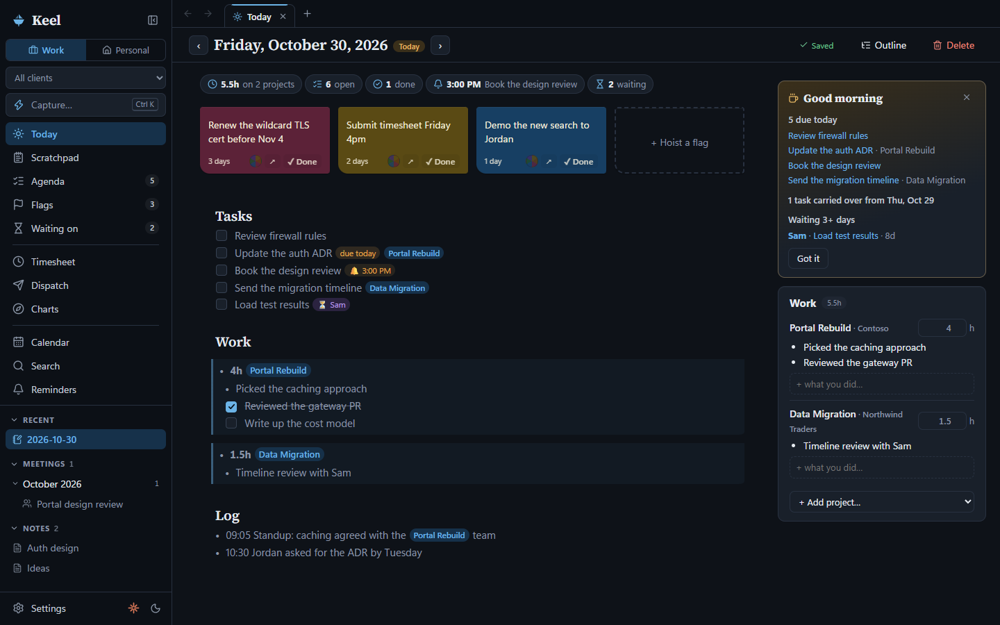

### Agenda

Everything that's overdue, due today or coming up in the next two weeks, across every file in the
Hold, next to today's reminders and the Flags you've hoisted.

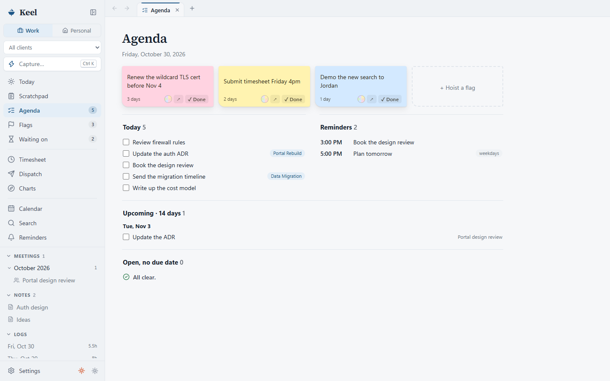

### Timesheet

Your week as projects × days. Click a number to copy it, or copy a row or the whole grid. Below it,
each project gets a day-by-day list of what you did, ready to paste into a time-tracking system's
notes field. Ticked tasks that belong to a project count as that day's work too.

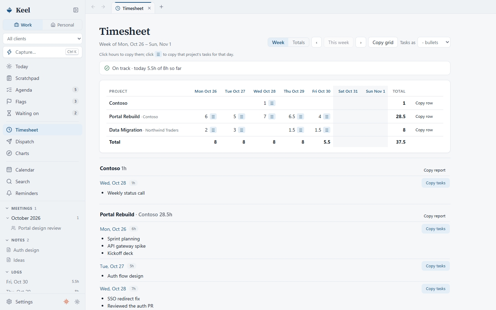

### Charts

Every client and project has a **Chart**: a reference page built from the bullets in its file. Links get
an open button, values and code blocks get a copy button, and Azure resource groups get a link to the
portal. Notes and meetings tied to the project are listed at the top.

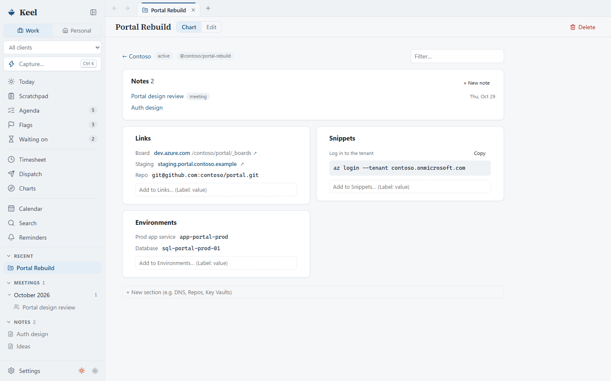

### Notes and meetings

Notes are markdown with live preview: headings, checkboxes, `[[wiki links]]` and Mermaid diagrams render
in place, and turn back into plain text when the cursor is on them. Meeting notes start from a template
with agenda, notes and action items, and can be created from a calendar event.

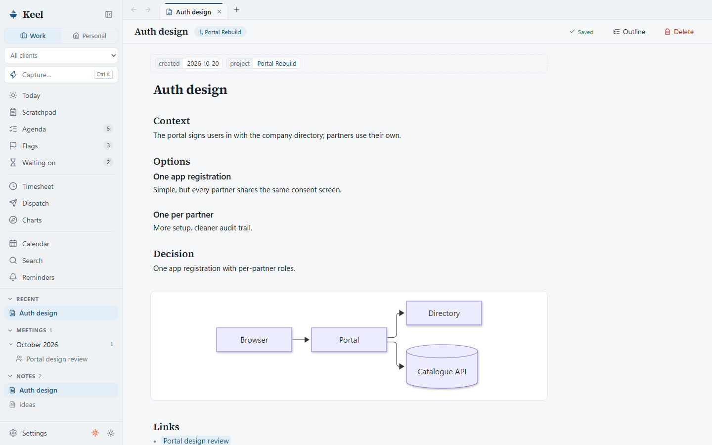

### Dispatch

A client status update for any week: hours by project, what you completed, meetings held, work in
progress, what you're waiting on and what's due next. Copy it for an email, or save it as a note.

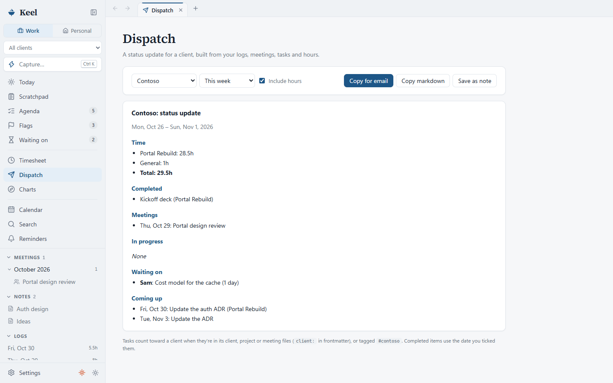

### Quick capture

Press **Ctrl+Alt+K** anywhere in Windows (or Ctrl+K inside Keel). Keel shows where the line will go
before you press Enter.

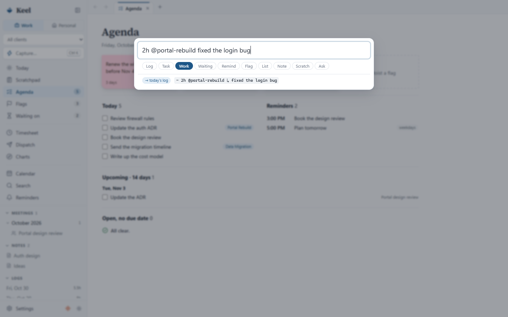

| Type | What happens |
|---|---|
| `6h @portal-rebuild` | Sets today's hours for that project |
| `@portal-rebuild fixed the login bug` | Adds an item under that project in today's Work |
| `todo buy printer ink` | Adds a task to today's log |
| `remind me 3pm call the bank` | Adds a reminder (also `tomorrow 9am …`) |
| `wait Jordan: firewall rules` | Adds an item to **Waiting on** |
| `flag renew the TLS cert` | Hoists a Flag |
| anything else | A timestamped line in today's log |

### Waiting on

Anything you're waiting on someone for, grouped by person, with how long it's been. Write
`@waiting(Jordan)` on a task, or end it with the person's name: `- [ ] Load test results @Sam`.

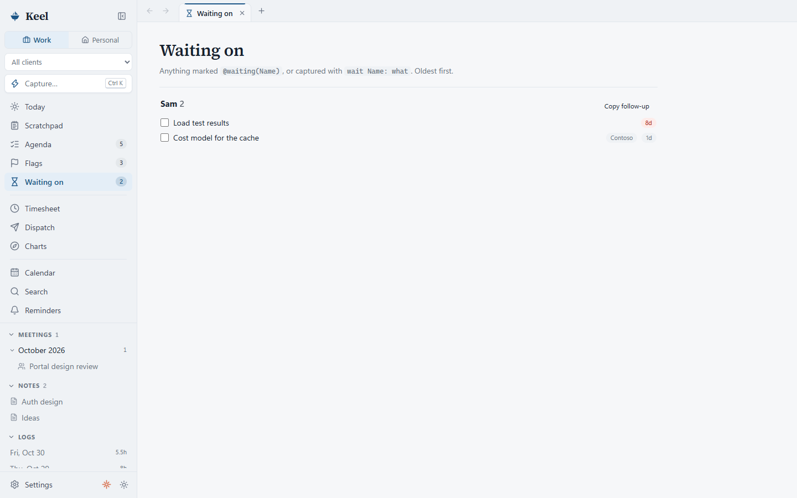

### Personal mode

Switch to **Personal** at the top of the sidebar for a separate space with its own logs, tasks and Flags,
plus **Lists** (shopping and anything else) and **Recipes**. Paste a recipe link to import it, and send
its ingredients to your shopping list in one click.

| Lists | Recipes |
|---|---|
| 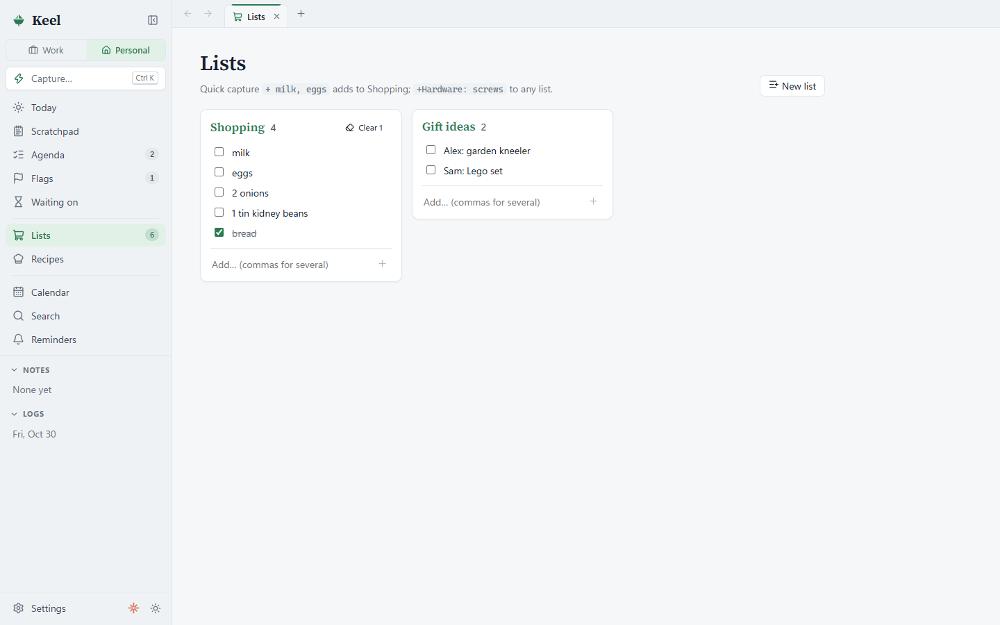 | 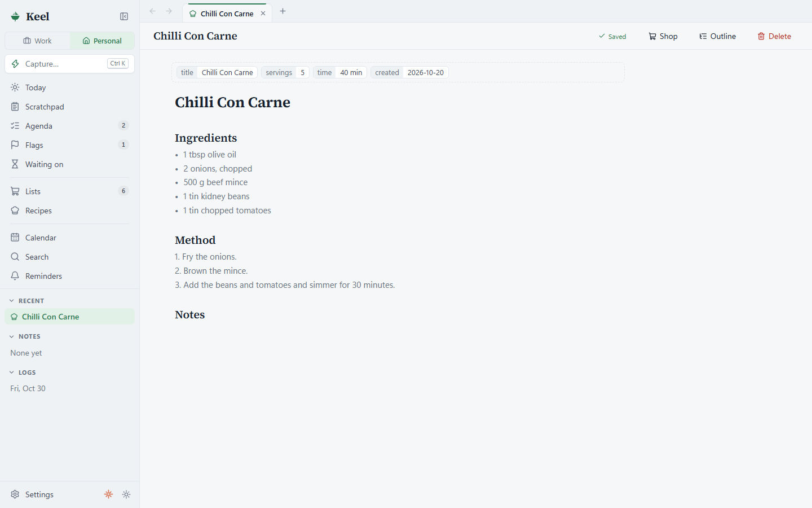 |

### Also included

- **Calendars:** subscribe to Outlook or Google calendars by their ICS link to see meetings in a
  month or week view, and start meeting notes from them.
- **Reminders:** Windows notifications, one-off or recurring (`daily`, `weekdays`, `mon,thu 9am`, `monthly 1`).
- **Scratchpad:** one plain-text page for jottings, with a button to move a line somewhere permanent.
- **File history:** automatic local snapshots (kept in a git repository inside the Hold, nothing is pushed),
  with a diff view and one-click restore.
- **Claude panel:** optionally runs [Claude Code](https://claude.com/claude-code) in a terminal docked
  under the main view, working in your Hold folder (Ctrl+\`).
- **Tray icon:** closing the window keeps Keel running for reminders and quick capture.

## How the files look

Keel's syntax is ordinary markdown with a few tokens. A day's log:

```markdown
---
date: 2026-10-30
---
# 2026-10-30

## Tasks
- [ ] Update the auth ADR @due(2026-10-30) @portal-rebuild
- [ ] Book the design review @remind(15:00)
- [ ] Load test results @waiting(Sam)

## Work
- 4h @portal-rebuild
  - Picked the caching approach
  - [x] Reviewed the gateway PR
- 1.5h @data-migration
  - Timeline review with Sam

## Log
- 09:05 Standup: caching agreed
```

Line syntax:

- Task: `- [ ] text`. `[x]` is done, `[>]` moved to a later day, `[-]` cancelled. Ticking a task stamps `@done(date)`.
- Due date: `@due(2026-10-21)`.
- Reminder: `@remind(14:00)`, `@remind(2026-12-24 18:00)`, `@remind(daily 08:00)`, `weekdays`, `weekends`, `mon,thu 9am`, `monthly 1 09:00`.
- Project or client: `@portal-rebuild`, `@contoso`, or `@contoso/portal-rebuild` (also `#portal-rebuild`). The key is the file name in lowercase with dashes.
- Hours: `- 2.5h @portal-rebuild`, `- 45m @contoso`, `- 1h30m @contoso …`, `- Worked 2h on @portal-rebuild`. Indent what you did under it.
- Waiting on: `@waiting(Jordan)`, or a person's capitalised `@Name` at the end of a task.
- Links: `[[Note name]]`.
- Chart item (in a client or project file): `- Label: value`, `- [Label](url)` or `- value`, grouped by `##` heading. Values in `` ` `` are copied without the backticks.

### Folder layout

```
logs/2026/2026-10-19.md        daily log (Tasks / Work / Log)
meetings/2026-10-19 Kickoff.md meeting notes
notes/…                        anything else, in any folders you like
clients/contoso.md             a client: frontmatter name; bullets = Chart items
projects/Portal Rebuild.md     a project: frontmatter client: contoso, status; bullets = Chart items
flags/….md                     Flags (sticky notes): frontmatter color, created, lowered
reminders.md                   recurring reminders
templates/{log,meeting,note,client}.md   how new files start; edit them freely
personal/…                     the personal space: logs, flags, lists/, recipes/
scratchpad.txt                 the Scratchpad
```

A new Hold includes a **Welcome to Keel** note with the full guide, and a `CLAUDE.md` that explains the
format to Claude Code.

## Install

Keel is a Windows desktop app built with [Tauri 2](https://tauri.app). Build the installer from source
(below); it lands in `src-tauri/target/<target>/release/bundle/nsis/`. The default Hold is
`C:\Users\<you>\Keel`, and you can pick another folder in Settings.

## Develop

Prerequisites: Node 20+, Rust (rustup), Visual Studio Build Tools with the C++ workload (plus the
ARM64 tools component on ARM machines).

```sh
npm install
npm run tauri dev       # run the app
npm test                # core logic tests (parser, schedule, hold)
npm run build:x64       # x64 installer
npm run build:arm64     # ARM64 installer
npm run build:all       # both
```

`npm run dev` runs the UI alone in a browser. There, the Hold lives in localStorage, which is handy
for UI work (no calendars, notifications or file history in that mode).

| Path | What |
|---|---|
| `src/core/` | Framework-free logic: markdown parsing, reminders, the Hold index, quick capture, reports. Unit tested. |
| `src/ui/` | React views and the CodeMirror 6 editor. |
| `src/lib/platform.ts` | Tauri calls (files, notifications, dialogs, autostart), with browser fallbacks. |
| `src-tauri/` | Rust shell: sandboxed file commands, file history, calendar fetching, tray icon, global Ctrl+Alt+K, single instance. |

Screenshots in this README use made-up sample data.
